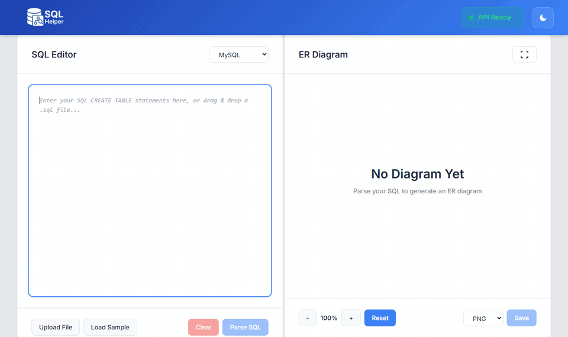
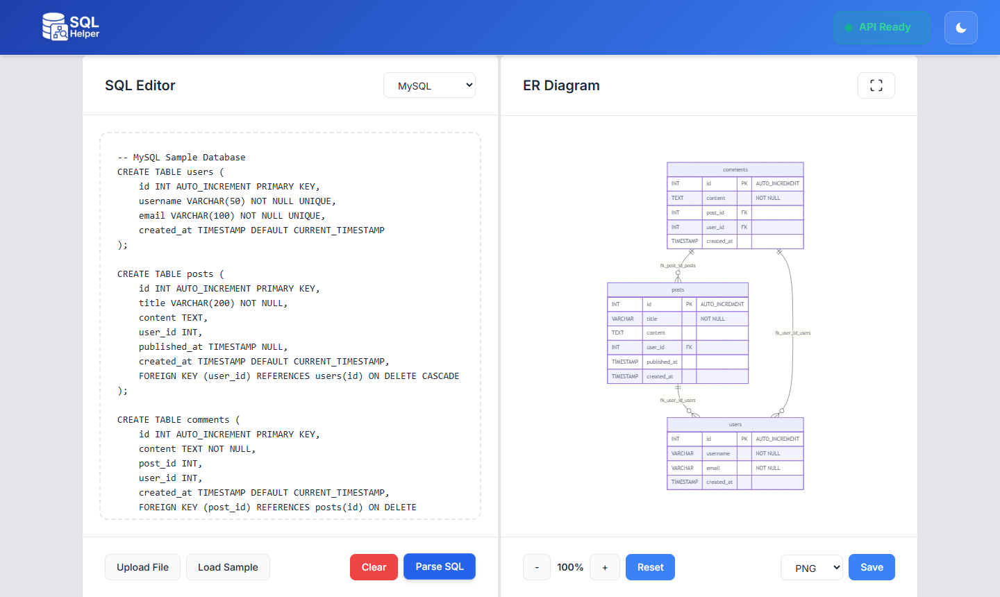
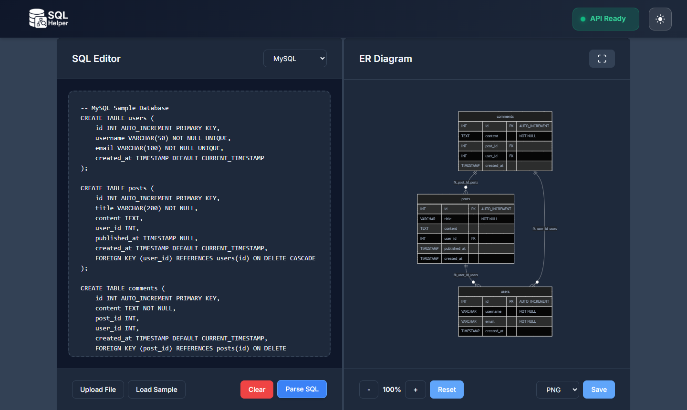

# SQLhelper

[](https://github.com/andresazcona/SQLhelper/actions/workflows/ci.yml)
[](LICENSE)


Paste SQL DDL, get an entity-relationship diagram. SQLhelper parses `CREATE TABLE` statements from MySQL, PostgreSQL, SQLite, SQL Server and Oracle, and renders them as [Mermaid](https://mermaid.js.org/) ER diagrams. The API also returns DBML and a JSON representation of the schema.



<details>
<summary>Screenshots</summary>





</details>

## Features

- Multi-dialect DDL parsing with automatic dialect detection
- Interactive diagram with zoom, pan and fullscreen
- Export as PNG, SVG or Mermaid source
- Drag-and-drop `.sql` file upload and built-in samples per dialect
- Light and dark themes, live API health indicator
- REST API with Zod validation, rate limiting, Helmet and Swagger docs at `/docs`

## Quick start

Requires Node.js 20+.

```bash
git clone https://github.com/andresazcona/SQLhelper.git
cd SQLhelper

# Terminal 1: API on http://localhost:3000
cd SQLhelper-back
npm install
npm run dev

# Terminal 2: UI on http://localhost:5173 (proxies /api to the backend)
cd SQLhelper-front
npm install
npm run dev
```

### Docker

```bash
# Build from source: UI on http://localhost, API on http://localhost:3000
docker compose up --build

# Development with hot reload: UI on http://localhost:5173
docker compose -f docker-compose.dev.yml up --build

# Pre-built images from Docker Hub (no build)
docker compose -f docker-compose.pull.yml up
```

## Configuration

Both files are optional; see the `.env.example` next to each service.

| Variable | Service | Default | Purpose |
| --- | --- | --- | --- |
| `PORT` | back | `3000` | API port |
| `NODE_ENV` | back | `development` | In development every CORS origin is allowed |
| `CORS_ORIGIN` | back | `http://localhost:3000` | Comma-separated allowed origins (non-development) |
| `RATE_LIMIT_WINDOW_MS` / `RATE_LIMIT_MAX` | back | `900000` / `100` | Rate limit window and max requests per IP |
| `LOG_LEVEL` | back | `info` | Pino log level |
| `VITE_API_URL` | front | `/api` | API base URL used by the UI |

## API

Interactive docs: `http://localhost:3000/docs`.

| Method | Path | Description |
| --- | --- | --- |
| `GET` | `/health` | Liveness probe |
| `POST` | `/api/detect` | Detect the SQL dialect of a DDL string |
| `POST` | `/api/parse` | Parse DDL and return Mermaid, DBML and JSON output |

```bash
curl -X POST http://localhost:3000/api/parse \
  -H "Content-Type: application/json" \
  -d '{"sql": "CREATE TABLE users (id INT PRIMARY KEY, name VARCHAR(50));", "dialect": "mysql"}'
```

`/api/parse` also accepts `options`: `inferDialect`, `includeIndexes`, `includeActions`, `strict`. Request bodies are limited to 10 MB.

## Tests

```bash
cd SQLhelper-back
npm test                 # Vitest: parser, dialect detection and API (supertest)
npm run test:coverage
npm run type-check
```

The frontend has no test suite; CI type-checks and builds it (`npm run build`). An optional Postman/Newman collection lives in `SQLhelper-back/postman` (`npm run test:api`, needs a running API).

## Project structure

```
SQLhelper/
├── SQLhelper-back/        # Express + TypeScript API
│   ├── src/
│   │   ├── routes/        # /api/detect, /api/parse
│   │   ├── services/      # DDL parser, dialect detection, output formatters
│   │   ├── middleware/    # Zod request validation
│   │   └── utils/         # Configuration
│   ├── tests/
│   └── postman/
├── SQLhelper-front/       # React + Vite UI
│   └── src/
│       ├── components/    # Editor, diagram panel, header, layout
│       ├── contexts/      # App state (theme, SQL, diagram)
│       ├── services/      # API client, Mermaid rendering, export
│       └── hooks/         # API health polling
├── docs/                  # Screenshots
└── docker-compose*.yml
```

## License

[MIT](LICENSE)
